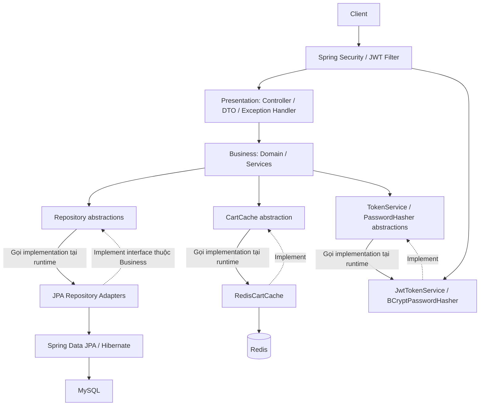
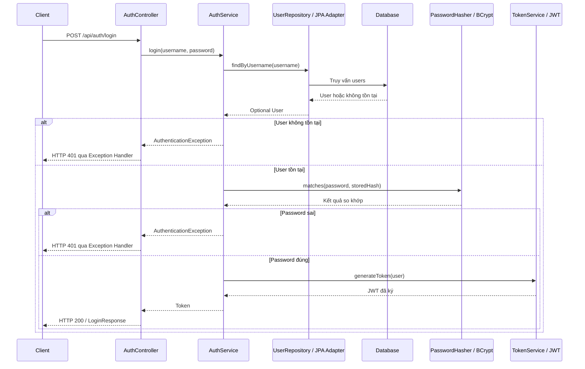
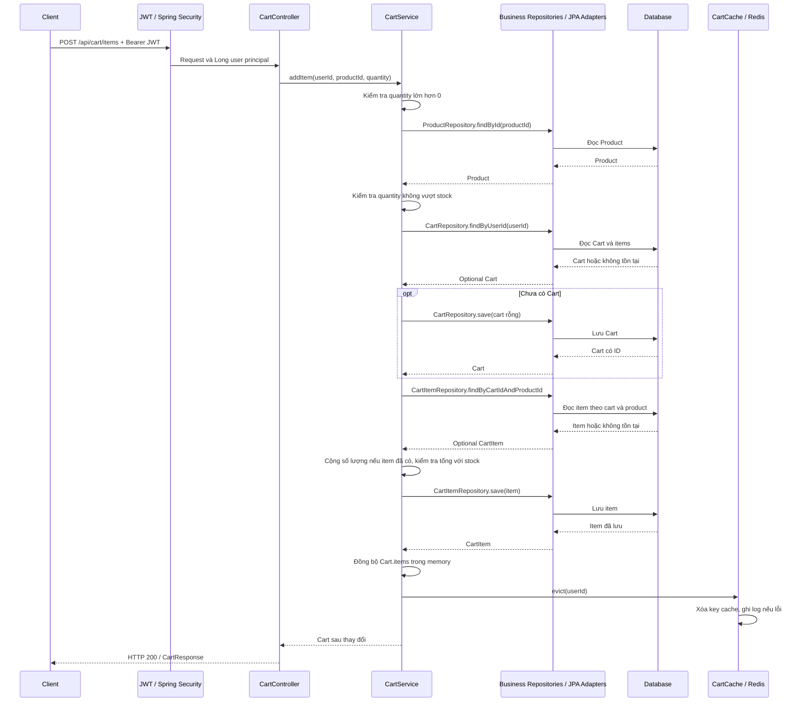
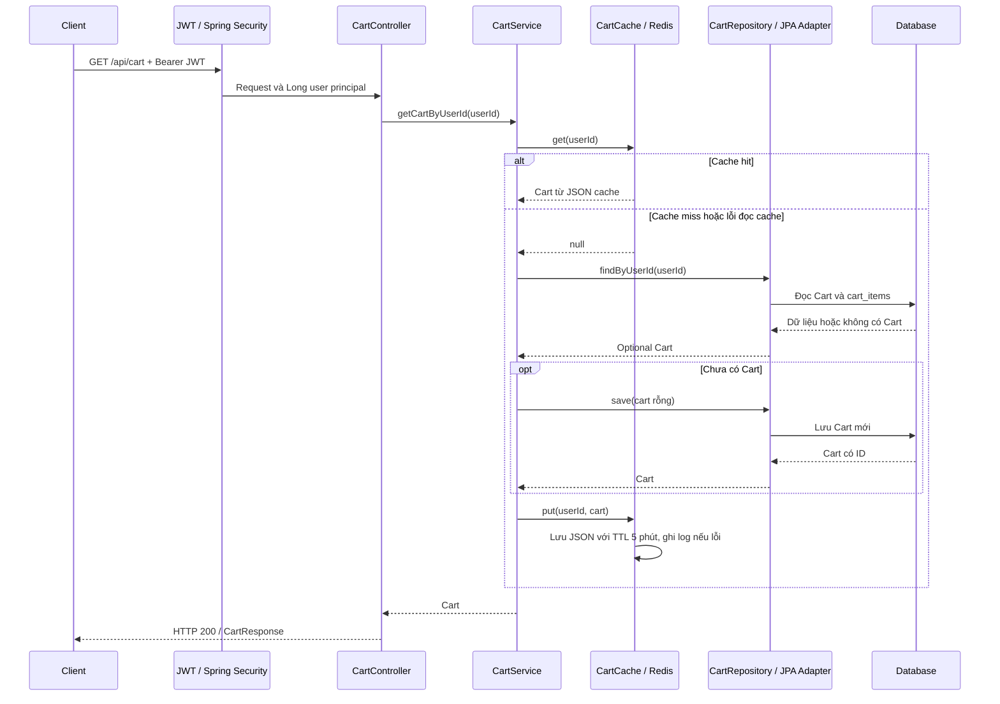

# Cart System — Kiến trúc và chức năng Phase 1

## 1. Giới thiệu dự án

Cart System là REST API quản lý giỏ hàng trong hệ thống thương mại điện tử. Hệ thống cho phép người dùng đăng ký, đăng nhập, xem sản phẩm và quản lý số lượng sản phẩm trong giỏ riêng. Các vấn đề chính gồm xác định chủ giỏ, kiểm tra tồn kho khi thay đổi số lượng, lưu dữ liệu bền vững và xử lý chênh lệch giữa dữ liệu lưu trữ với cache.

## 2. Chức năng hệ thống

| Nhóm | Chức năng đã triển khai | Quy tắc và phạm vi |
|---|---|---|
| Authentication | Đăng ký tài khoản | Kiểm tra username đã tồn tại; hash password trước khi lưu; không trả password trong response. |
| Authentication | Đăng nhập | Kiểm tra username và password; trả token khi xác thực thành công. |
| Authentication | Xác thực JWT | Kiểm tra chữ ký, issuer và thời hạn; lấy user ID từ subject để xác thực Cart API. |
| Product | Xem danh sách sản phẩm | Trả danh sách qua ProductResponse; chưa có phân trang hoặc bộ lọc. |
| Product | Xem chi tiết sản phẩm | Tìm theo ID; báo lỗi khi sản phẩm không tồn tại. |
| Cart | Xem giỏ hàng | Cache-Aside; nếu chưa có giỏ thì tạo và lưu giỏ rỗng. |
| Cart | Thêm sản phẩm | Tạo giỏ nếu cần; cộng số lượng nếu sản phẩm đã có trong giỏ. |
| Cart | Cập nhật số lượng | Thay số lượng của item hiện có; không tạo item mới. |
| Cart | Xóa sản phẩm khỏi giỏ | Xóa CartItem; giữ nguyên Cart và Product. |
| Cart | Kiểm tra tồn kho | Số lượng phải dương và không vượt stock khi thêm hoặc cập nhật; không giảm hay giữ chỗ stock. |
| Cart | Xác định giỏ của người dùng | Dùng user ID từ JWT principal; tìm cart theo user và item theo cặp cart ID/product ID. |
| Health | Phản hồi trạng thái API | Trả trạng thái cố định UP; không kiểm tra kết nối database hoặc Redis. |

## 3. Kiến trúc tổng thể

Sơ đồ thể hiện luồng gọi tại runtime và các quan hệ implement. **Hướng phụ thuộc source** là Presentation → Business; Business → các interface do Business sở hữu; Infrastructure → các interface và domain của Business. Business không import Infrastructure, Spring, JPA, Hibernate, Redis, JWT hoặc HTTP.

Kiến trúc phân lớp tách hợp đồng HTTP, quy tắc nghiệp vụ và chi tiết lưu trữ. Dependency Inversion đặt Repository, TokenService, PasswordHasher và CartCache trong Business, cho phép service sử dụng abstraction thay vì phụ thuộc công nghệ cụ thể. `InfrastructureConfiguration` nối các implementation với service bằng constructor injection và khai báo Spring bean bên ngoài Business.

JPA adapters thực hiện vai trò Data Access. Security/JWT là hạ tầng xuyên suốt xử lý request và xác thực, không phải một tầng nghiệp vụ mới. Redis là cache bổ trợ; database là nguồn dữ liệu chính.

## 4. Thiết kế các tầng

### Presentation Layer

Các thành phần nằm trong `presentation`:

- **Controller:** AuthController, ProductController, CartController và HealthController tiếp nhận HTTP request, gọi service và tạo response. Controller không truy cập JPA repository.
- **DTO:** tách cấu trúc request/response khỏi domain. RegisterResponse không chứa password; CartItemResponse chỉ trình bày productId và quantity. Controller thực hiện chuyển đổi domain sang DTO.
- **Validation:** Spring MVC chuyển đổi JSON và tham số sang kiểu Java. DTO chưa có Bean Validation constraints và Controller chưa dùng `@Valid`; kiểm tra quantity và stock nằm ở Business. Vì vậy chưa thể khẳng định mọi input thiếu hoặc sai định dạng đều trả HTTP 400.
- **Exception Handling:** GlobalExceptionHandler chuyển Business exception sang ErrorResponse gồm status, message và timestamp. Lỗi ngoài các nhóm được khai báo trả HTTP 500 với thông báo chung, không trả stack trace hoặc tên class exception.

| Nhóm Business exception | HTTP status |
|---|---|
| ProductNotFoundException, CartNotFoundException, CartItemNotFoundException | 404 |
| UserAlreadyExistsException | 409 |
| AuthenticationException | 401 |
| InvalidCartItemException, InsufficientStockException | 400 |
| Exception chưa được xử lý riêng | 500 |

Lỗi xác thực hoặc phân quyền tại SecurityFilterChain sử dụng `sendError(401/403)`; chưa có bảo đảm chúng dùng cùng ErrorResponse của ControllerAdvice.

### Business Layer

Các thành phần nằm trong `business` và sử dụng Java thuần:

- **Domain Model:** User, Product, Cart và CartItem biểu diễn dữ liệu nghiệp vụ, không có JPA annotation. Các model có constructor, getter và setter; quy tắc thao tác giỏ được kiểm tra tại service.
- **AuthService:** đăng ký, kiểm tra password và yêu cầu tạo token qua PasswordHasher/TokenService.
- **ProductService:** đọc danh sách, chi tiết sản phẩm qua ProductRepository.
- **CartService:** đọc giỏ qua cache, thêm/cập nhật/xóa item, kiểm tra quantity/stock và yêu cầu evict sau khi ghi thành công.
- **Repository interfaces:** UserRepository, ProductRepository, CartRepository và CartItemRepository chỉ trao đổi domain model, List và Optional; không kế thừa Spring Data repository.
- **Các abstraction bổ trợ:** PasswordHasher, TokenService và CartCache che giấu BCrypt, JWT và Redis.

Service nhận dependency qua constructor, không có Spring annotation. CartService luôn xác định cart thao tác bằng `findByUserId(userId)`; user ID tại biên HTTP đến từ principal đã được xác thực, không đến từ header X-User-Id hay request body.

### Infrastructure và Data Access

Các thành phần nằm trong `infrastructure`:

- **Persistence:** các RepositoryAdapter implement Business repository và gọi JpaRepository tương ứng. Adapter chuyển đổi Entity ↔ Domain bằng các hàm mapping nội bộ; CartRepositoryAdapter đọc thêm cart_items để dựng Cart có danh sách items.
- **Database mapping:** UserEntity, ProductEntity, CartEntity và CartItemEntity chứa annotation JPA. ID được persistence tạo; Business không tự sinh ID. Cấu hình hiện dùng Hibernate `ddl-auto=update`, chưa có migration có phiên bản.
- **JWT:** JwtTokenService implement TokenService, ký HS256 và tạo claims subject, username, issuer, thời điểm phát hành, thời điểm hết hạn. TTL mặc định là 15 phút. JwtAuthenticationFilter kiểm tra token Bearer và đặt Long user ID vào SecurityContext.
- **Spring Security:** session stateless; Cart API yêu cầu xác thực; Auth, Product, Health và tài liệu OpenAPI được public. Các request còn lại bị deny. Form login, HTTP Basic, logout và CSRF bị tắt trong cấu hình API hiện tại.
- **Cache:** RedisCartCache implement CartCache, lưu JSON với key `cart:user:<userId>` và TTL 5 phút. Cache hit không gia hạn TTL. Lỗi đọc được coi là cache miss; lỗi ghi hoặc evict được ghi log và không ném tiếp từ adapter.
- **Password hashing:** BCryptPasswordHasher implement PasswordHasher bằng BCryptPasswordEncoder. AuthService chỉ lưu password đã hash qua luồng đăng ký.

## 5. Mô hình dữ liệu

| Domain | Thuộc tính thực tế | Bảng / ý nghĩa |
|---|---|---|
| User | `Long id`, `String username`, `String password` | `users`; password chứa hash khi lưu qua AuthService. |
| Product | `Long id`, `String name`, `BigDecimal price`, `Integer stock` | `products`; giá và tồn kho hiện tại của sản phẩm. |
| Cart | `Long id`, `Long userId`, `List<CartItem> items` | `carts` lưu id và user_id; items được adapter tổng hợp từ cart_items. |
| CartItem | `Long id`, `Long cartId`, `Long productId`, `Integer quantity` | `cart_items`; số lượng một sản phẩm trong một giỏ. |

Quan hệ logic: User sở hữu tối đa một Cart theo unique mapping của user_id; Cart chứa nhiều CartItem; mỗi CartItem tham chiếu một Product qua product_id. Mapping khai báo username duy nhất và cặp `(cart_id, product_id)` duy nhất.

Các Entity dùng ID dạng scalar, không khai báo quan hệ `@OneToMany`, `@ManyToOne` hoặc khóa ngoại qua JPA relationship mapping. Các quan hệ trên mô tả ý nghĩa của các ID và luồng truy vấn; không phải xác nhận rằng database triển khai đã có physical foreign key.

CartItem không chứa giá tại thời điểm thêm. Cart không chứa tổng tiền. Việc lưu Cart không tự lưu cả danh sách items; CartService lưu hoặc xóa từng CartItem qua repository riêng.

## 6. Luồng xử lý nghiệp vụ

### 6.1. Đăng nhập và nhận JWT

AuthService không biết token được tạo bằng JWT. Ở các request Cart tiếp theo, filter kiểm tra JWT trước Controller và lấy user ID từ subject. Không có truy vấn lại tài khoản trong database ở filter hiện tại.

### 6.2. Thêm sản phẩm vào giỏ

Sơ đồ mô tả đường xử lý thành công; các bước kiểm tra không đạt sẽ kết thúc bằng Business exception.

Quantity không hợp lệ bị từ chối trước repository call. Product thiếu trả lỗi not-found; quantity ban đầu hoặc tổng sau khi cộng vượt stock trả lỗi insufficient-stock. Service không giảm stock. Eviction được gọi sau save thành công; GET tiếp theo sẽ đọc database nếu key đã bị xóa.

### 6.3. Truy vấn giỏ với Cache-Aside

GET cart có thể tạo dữ liệu khi user chưa có giỏ. Redis không quyết định dữ liệu lưu bền vững. Add, update và delete đọc qua repository, đồng bộ Cart.items rồi evict; chúng không cập nhật trực tiếp giá trị cache bằng response mới.

## 7. Các quyết định kiến trúc

| Problem — Vấn đề | Quality Attribute | Solution — Giải pháp hiện tại | Trade-off — Đánh đổi |
|---|---|---|---|
| Xác định danh tính khi gọi Cart API | Security, Extensibility | JWT Bearer, kiểm tra chữ ký/issuer/expiry, principal chứa user ID, session stateless | Phải quản lý khóa và thời hạn; chưa có thu hồi token, refresh token hoặc kiểm tra user còn tồn tại tại mỗi request. |
| Business bị gắn với cách truy vấn database | Maintainability, Testability | Repository Pattern; adapter chuyển Entity ↔ Domain | Thêm interface và mapping; đổi persistence vẫn phải kiểm tra tương thích hành vi của contract. |
| Service phụ thuộc trực tiếp JWT, BCrypt hoặc Redis | Maintainability, Extensibility | Dependency Inversion qua TokenService, PasswordHasher, CartCache và constructor injection | Cần cấu hình nối bean và duy trì contract giữa các implementation. |
| Truy vấn lặp lại cùng một giỏ | Performance | Redis Cache-Aside, TTL 5 phút, evict sau ghi | Tăng chi phí mạng/JSON và vận hành; cache có thể cũ khi eviction lỗi hoặc request chạy đồng thời; chưa có benchmark Kaggle hoặc phép đo so sánh bật/tắt cache. |
| Trộn HTTP, nghiệp vụ và persistence | Maintainability, Testability | Layered Architecture; Controller dùng DTO/service, Business Java thuần, Data Access ở adapters | Tăng số thành phần và công việc chuyển đổi dữ liệu. |
| Quy tắc nghiệp vụ và lỗi HTTP cần ranh giới rõ | Maintainability, Security | Service kiểm tra quantity/stock; Business exception được handler chuyển sang HTTP; catch-all dùng message chung | Validation input chưa đầy đủ; lỗi Security và MVC chưa được chuẩn hóa hoàn toàn cùng ErrorResponse. |

## 8. Thuộc tính chất lượng

| Thuộc tính | Cơ chế trong source | Giới hạn đánh giá |
|---|---|---|
| Maintainability — Khả năng bảo trì | Business thuần Java; DTO và Entity riêng; configuration nối dependency bên ngoài service | Thay đổi contract cần phối hợp mapping, Controller và adapter. |
| Testability — Khả năng kiểm thử | Constructor injection cho phép mock repository/cache/security ports; MVC và security có phạm vi kiểm thử riêng | Mock không chứng minh database mapping, cache thật hay wiring đầy đủ. |
| Security — Bảo mật | BCrypt, JWT có chữ ký/thời hạn, giỏ lấy owner từ principal, response đăng ký không có password | Chưa có role, thu hồi token, rate limiting hoặc validation input đầy đủ; không suy ra an toàn triển khai chỉ từ các cơ chế này. |
| Performance — Hiệu năng | Cache hit bỏ qua truy vấn Cart vào database; TTL giới hạn tuổi của giá trị cache | Đã có phép đo smoke/low local riêng; chưa xác định năng lực production hoặc lợi ích riêng của cache. Serialize và Redis cũng có chi phí. |
| Data Consistency — Nhất quán dữ liệu | Database là nguồn chính; unique mapping; evict sau ghi và cập nhật items trong object trả về | Chưa có transaction bao trùm workflow, optimistic locking hoặc cơ chế đồng bộ mạnh giữa database/cache. |
| Extensibility — Khả năng mở rộng | Các implementation có thể thay thế qua Business interfaces; boundary HTTP tách khỏi domain | Đơn hàng, giữ chỗ stock hoặc thay đổi contract cần thiết kế mới; abstraction hiện tại không tự giải quyết các nghiệp vụ đó. |

## 9. Tổng quan API

| HTTP Method | Endpoint | Chức năng | Yêu cầu xác thực |
|---|---|---|---|
| POST | `/api/auth/register` | Đăng ký tài khoản | Public |
| POST | `/api/auth/login` | Đăng nhập và nhận token | Public |
| GET | `/api/products` | Danh sách sản phẩm | Public |
| GET | `/api/products/{id}` | Chi tiết sản phẩm | Public |
| GET | `/api/cart` | Giỏ của người dùng hiện tại | Bearer JWT |
| POST | `/api/cart/items` | Thêm sản phẩm hoặc cộng số lượng | Bearer JWT |
| PUT | `/api/cart/items/{productId}` | Thay số lượng item hiện có | Bearer JWT |
| DELETE | `/api/cart/items/{productId}` | Xóa item khỏi giỏ | Bearer JWT |
| GET | `/api/health` | Trạng thái cố định UP | Public |

OpenAPI khai báo scheme HTTP Bearer với bearerFormat JWT và security requirement cho bốn Cart operations; Swagger UI có chức năng Authorize. Năm operations còn lại không yêu cầu Bearer. Chi tiết DTO và HTTP response được giữ trong [tài liệu API](docs/api.md).

## 10. Giới hạn và hướng phát triển

### Hiện trạng

- Chưa có checkout, order, payment, coupon, tổng tiền hoặc giá snapshot. Thêm item không giữ chỗ và không trừ tồn kho.
- Chưa có API quản trị sản phẩm, phân trang, bộ lọc, role, refresh token hoặc thu hồi token.
- Validation request chưa bao phủ trường null, chuỗi rỗng và giới hạn độ dài. Quantity null có thể lỗi unboxing; handler tổng quát có thể trả 500 cho một số lỗi input.
- GET cart tạo giỏ rỗng nếu thiếu, trong khi annotation OpenAPI vẫn mô tả thêm lỗi 404 cho endpoint này. Tài liệu này mô tả theo service thực tế.
- Workflow ghi nhiều bước chưa có transaction bao trùm hoặc kiểm soát lost update. Kiểm tra username trước save không tự ngăn cuộc đua đăng ký đồng thời; lỗi unique constraint chưa được chuyển riêng thành lỗi nghiệp vụ.
- Cache invalidation là best-effort. Eviction thất bại có thể giữ dữ liệu cũ đến hết TTL; request đọc đồng thời có thể ghi lại snapshot cũ sau eviction.
- JPA hiện dùng scalar ID và `ddl-auto=update`; chưa có migration có phiên bản hoặc xác nhận schema thực tế bằng kiểm tra database. Khả năng dùng MariaDB chưa được xác minh.
- Health phản hồi cố định; chưa phản ánh readiness của database/Redis. Chưa có benchmark Kaggle hoặc căn cứ xác nhận năng lực chịu tải production.

### Đề xuất cho giai đoạn tiếp theo

1. Hoàn thiện validation request và thống nhất cấu trúc lỗi MVC/Security; đối chiếu lại OpenAPI với hành vi service.
2. Xác định transaction boundary, xử lý ghi đồng thời và chính sách cache consistency; kiểm chứng bằng integration tests với database và Redis thật.
3. Quản lý schema bằng migration và xác minh constraints; đánh giá MariaDB riêng nếu chọn làm nền tảng triển khai.
4. Bổ sung quan sát hệ thống, readiness và đo hiệu năng trước khi điều chỉnh cache/query.
5. Thiết kế vòng đời token, phân quyền và nghiệp vụ đặt hàng/giữ chỗ tồn kho khi phạm vi sản phẩm yêu cầu.

Các mục đề xuất chưa được triển khai trong Phase 1. Tài liệu bổ trợ được giữ tại [mục lục docs](docs/README.md), [kiến trúc chi tiết](docs/architecture.md), [API](docs/api.md) và [kiểm thử](docs/testing.md). Cấu hình đóng gói nằm trong [Docker](docs/docker.md); bộ phát tải và trạng thái kiểm chứng thực tế nằm trong [Load testing và Kaggle CPU](docs/load-testing.md). Có notebook không đồng nghĩa đã chạy benchmark Kaggle.
