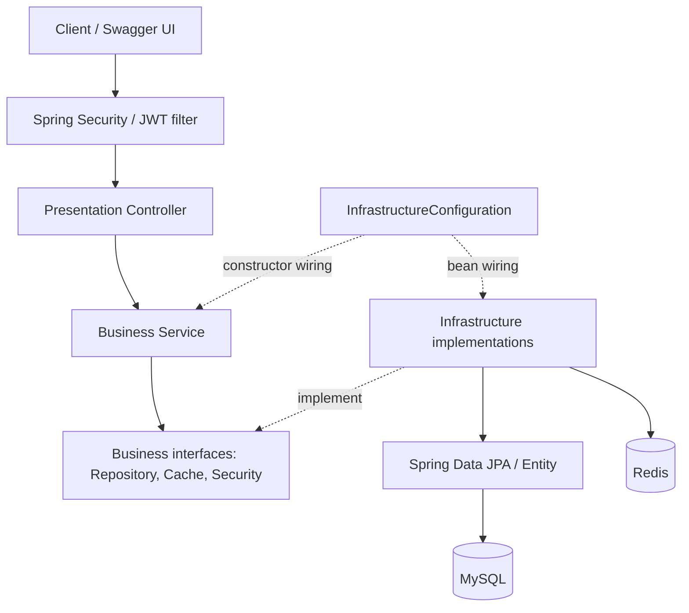
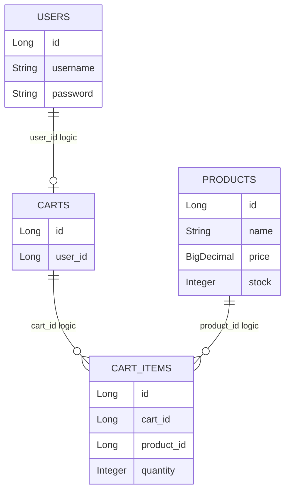
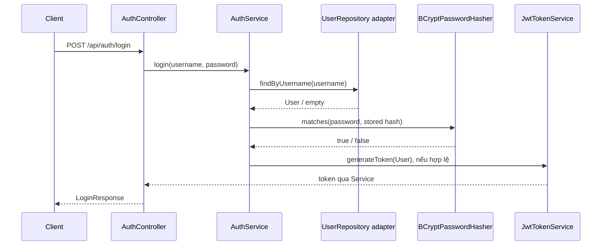
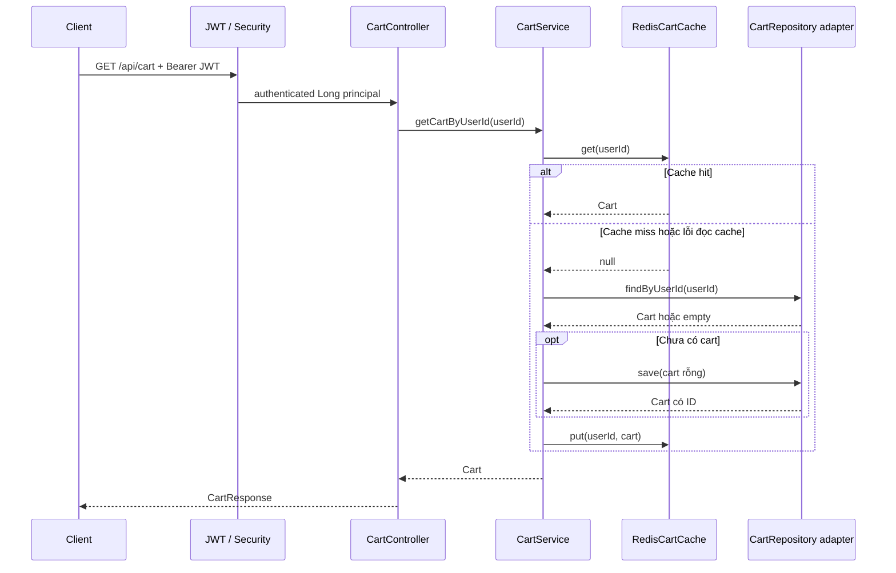

# Kiến trúc Cart System - Phase 1

## Tổng quan và hướng phụ thuộc

Repository triển khai Presentation, Business và Infrastructure. Phần Data Access nằm trong `infrastructure/persistence`; security và cache là các thành phần hạ tầng dùng chung.

Mũi tên `implement` thể hiện dependency source từ Infrastructure vào interface Business. Khi chạy, Service gọi interface và Spring cung cấp implementation. Business không import Spring, HTTP, JPA, Hibernate, Redis hay JWT libraries.

## Presentation

`presentation/controller` chứa Auth, Product, Cart và Health Controller. Controller nhận HTTP input, gọi Service, chuyển domain sang response DTO và xác định status. Không truy cập JPA repositories. DTO là Java records; password chỉ có trong request. `GlobalExceptionHandler` chuyển Business exception thành `ErrorResponse`.

CartController nhận `Long userId` qua `@AuthenticationPrincipal`; đường xử lý hiện tại không đọc `X-User-Id`. OpenAPI metadata và `bearerAuth` được khai báo ở `CartSystemApplication`, requirement đặt trên CartController.

## Business

`AuthService`, `ProductService`, `CartService` là concrete Java classes, không phải service interfaces và không có Spring annotation. Các dependency được nhận qua constructor. Interfaces nằm ở `business/repository`, `business/security`, `business/cache`.

| Domain | Field và kiểu |
|---|---|
| `User` | `Long id`, `String username`, `String password` |
| `Product` | `Long id`, `String name`, `BigDecimal price`, `Integer stock` |
| `Cart` | `Long id`, `Long userId`, `List<CartItem> items` |
| `CartItem` | `Long id`, `Long cartId`, `Long productId`, `Integer quantity` |

`User.password` nhận giá trị đã hash khi đăng ký. Cart giữ danh sách mutable được sao chép từ input constructor/setter; Domain không tự kiểm tra đầy đủ invariants. Quy tắc quantity và stock nằm trong CartService. Thêm item hiện có cộng quantity; update thay thế quantity; delete chỉ xóa item. Không trừ stock, không tính total/subtotal và không checkout.

Sơ đồ thể hiện liên kết logic. Entity hiện lưu các ID dạng scalar; chưa khai báo JPA relationship/FK annotation, nên không suy ra FK constraint thực tế từ sơ đồ.

## Infrastructure và Repository Pattern

`InfrastructureConfiguration` tạo Service beans, PasswordHasher, JwtTokenService, JwtAuthenticationFilter và CartCache. Bốn `@Repository` adapters implement đúng Business interfaces, nhận Spring Data repository qua constructor và map Entity ↔ Domain bằng private methods. Chưa có package Mapper riêng.

| Interface Business | Contract |
|---|---|
| `UserRepository` | `findByUsername` → Optional; `save` → User |
| `ProductRepository` | `findAll` → List; `findById` → Optional |
| `CartRepository` | `findByUserId`, `findById` → Optional; `save` → Cart |
| `CartItemRepository` | `findByCartIdAndProductId` → Optional; `findByCartId` → List; `save`; `delete` |
| `PasswordHasher` | `hash(password)`, `matches(password, hashedPassword)` |
| `TokenService` | `generateToken(User)` |
| `CartCache` | `get(userId)` trả Cart hoặc null; `put`; `evict` |

JPA entities map bốn bảng `users`, `products`, `carts`, `cart_items`; ID dùng `IDENTITY`. Unique constraints được khai báo cho username, `carts.user_id` và `(cart_id, product_id)`. `CartRepositoryAdapter` truy vấn cart rồi lấy các item bằng `findByCartId` để hydrate Domain. Save Cart lưu hàng cart; save/delete item dùng repository riêng.

MySQL là nguồn dữ liệu chính. `ddl-auto=update` tạo/cập nhật schema khi khởi động; chưa có migration hoặc seed data. Driver là MySQL Connector/J; MariaDB chưa được kiểm chứng trong phiên này. Không có transaction bao toàn bộ workflow Cart hoặc optimistic locking trong source hiện tại.

## Luồng JWT authentication

Register kiểm tra username, hash password, tạo User không tự sinh ID và gọi save. JwtTokenService ký HS256 bằng khóa Base64 từ cấu hình; claims có issuer `cart-system`, subject là user ID, username, issued-at và expiration. TTL mặc định 15 phút.

JwtAuthenticationFilter xác minh chữ ký, issuer và expiry, parse subject thành Long, rồi đặt principal vào SecurityContext. Token lỗi xóa context; SecurityFilterChain quyết định quyền truy cập. Cart yêu cầu authenticated; auth/products/health và Swagger được permitAll; endpoint khác denyAll. Security stateless, không form login/httpBasic/logout, CSRF bị tắt. Chưa có role, refresh token, revoke token hoặc kiểm tra lại user tồn tại trong DB ở filter.

## Luồng Cart và Cache-Aside

Key Redis là `cart:user:<userId>`, JSON chứa Cart và items, TTL 5 phút. TTL được đặt khi put; cache hit không gia hạn TTL. Cache read/deserialization lỗi được ghi log và coi là miss. Cache write lỗi được ghi log; request không bị ném cache exception từ implementation này.

## Cache invalidation

Add/update/delete lấy dữ liệu qua Repository, save/delete CartItem, đồng bộ `Cart.items`, rồi gọi `evict(userId)`. Không cập nhật Redis bằng kết quả write; lần GET sau miss sẽ đọc database và cache lại.

Eviction là best-effort: nếu delete key lỗi, key cũ có thể còn đến hết TTL. Request đọc đồng thời với write cũng có thể put dữ liệu cũ sau eviction. Hiện chưa có cơ chế đảm bảo consistency mạnh giữa database và Redis hoặc xử lý lost update khi hai request ghi đồng thời.

## Xử lý lỗi

Handler map Business exception sang 400, 401, 404, 409; catch-all trả 500 cùng message chung. Chi tiết ở [API](api.md). Lỗi Security trước Controller dùng `sendError(401/403)`, không được bảo đảm có cùng JSON ErrorResponse. Request DTO chưa có Bean Validation constraints; một số lỗi body có thể rơi vào catch-all 500.

## Quyết định và đánh đổi

| Vấn đề | Thuộc tính chất lượng | Quyết định | Đánh đổi |
|---|---|---|---|
| Framework ảnh hưởng business rules | Maintainability | Domain/Service thuần Java; ports và constructor injection | Cần mapping và bean configuration |
| Khó test business với DB/cache | Testability | Mock Business interfaces trong unit tests | Không kiểm chứng persistence/cache thực tế |
| Xác định chủ giỏ từ client | Security | JWT principal qua filter và Spring Security | Quản lý khóa/expiry; chưa có revoke hoặc user lookup |
| Lặp truy vấn cart | Performance | Redis Cache-Aside, TTL 5 phút | Thêm serialize/network; benchmark hiện mới ở mức Smoke, chưa so sánh khi bật và tắt cache |
| Cache khác dữ liệu sau write | Data consistency | Database lưu chính, evict sau write | Eviction lỗi và race có thể giữ cache cũ |
| Tách dữ liệu HTTP và domain | Maintainability / Security | DTO riêng; không trả password hoặc ID nội bộ item | Cần chuyển đổi trong Controller |
| Chuẩn bị schema nhanh cho Phase 1 | Maintainability | Hibernate `ddl-auto=update` | Chưa có lịch sử migrations và quy trình rollback schema |
